# Universidad Mayor, Real y Pontificia de San Francisco Xavier de Chuquisaca
# Facultad de Tecnología

# Examen Segundo Parcial

  

- **Carrera:** Ingeniería en Telecomunicaciones
- **Materia:** Trabajando en la Nube
- **Docente:** Ing. Marcelo Quispe Ortega
- **Estudiante:** Vargas Alarcón Brayan Mario
- **Repositorio GitHub:** [https://github.com/TheBranx/api-libros-aws-cicd](https://github.com/TheBranx/api-libros-aws-cicd)
- **Docker Hub Registry:** [https://hub.docker.com/r/thebranx/api-libros](https://hub.docker.com/r/thebranx/api-libros)
- **URL Pública API (EC2):** [http://52.15.197.239/health](http://52.15.197.239/health) · [http://52.15.197.239/libros](http://52.15.197.239/libros)
- **Workflow Run CI:** [https://github.com/TheBranx/api-libros-aws-cicd/actions/workflows/ci.yml](https://github.com/TheBranx/api-libros-aws-cicd/actions/workflows/ci.yml)
- **Workflow Run CD:** [https://github.com/TheBranx/api-libros-aws-cicd/actions/runs/44642468474](https://github.com/TheBranx/api-libros-aws-cicd/actions/runs/44642468474)

---

## 1. Introducción y Enlaces de Verificación de la Tarea

- **Tema 4 (Ejercicio 1):** Implementación de una API RESTful con Node.js y Express para gestionar un catálogo de libros en una instancia Amazon EC2 Linux, con persistencia relacional en una base de datos Amazon RDS for MySQL privada, exponiendo el servicio mediante el proxy inverso Nginx en el puerto 80 y garantizando que los puertos internos 3000 y 3306 permanezcan cerrados al tráfico público de Internet.
- **Tema 5 (Ejercicio 2):** Automatización completa del flujo de pruebas unitarias/integración aisladas (Jest y Supertest), empaquetamiento en contenedor Docker multi-stage optimizado y despliegue continuo hacia Amazon EC2 mediante GitHub Actions, con verificación de salud previa (Zero-Downtime) y preservación de versión ante fallos (Rollback automático).

---

## 2. Ejercicio 1 — API REST en EC2 con Amazon RDS MySQL

### 2.1 Configuración de Grupos de Seguridad (EC2 y RDS)

Para garantizar la seguridad de la arquitectura en la VPC de AWS, configuré dos grupos de seguridad separados con reglas de mínimo privilegio:

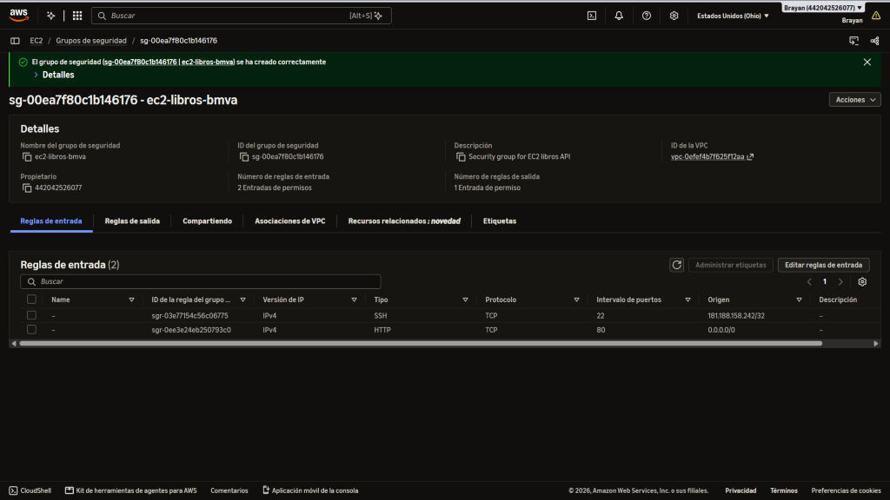
Reglas de entrada del Grupo de Seguridad de EC2 (`ec2-libros-bmva`). Se configuró inicialmente el puerto SSH (22) restringido a mi dirección IP pública (`181.188.158.242/32`) y el puerto HTTP (80) abierto a Internet (`0.0.0.0/0`).

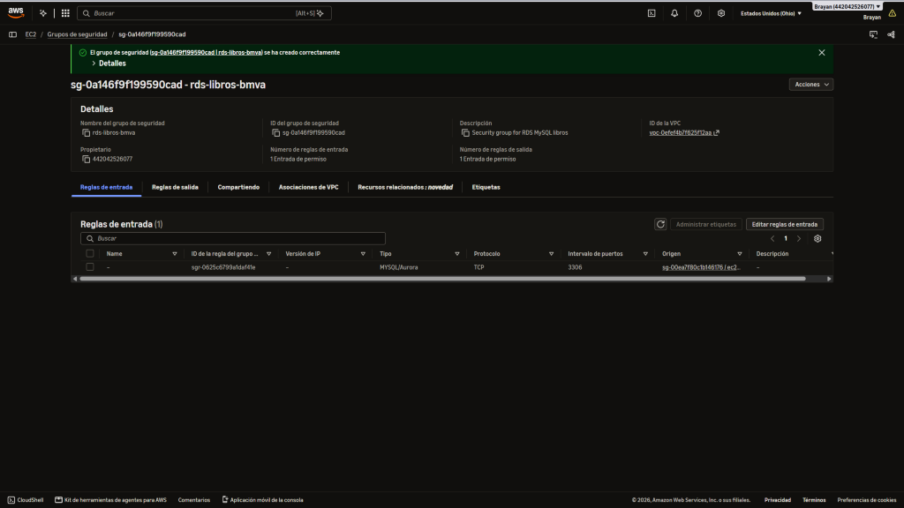
Reglas de entrada del Grupo de Seguridad de RDS (`rds-libros-bmva`). Se autorizó el puerto MySQL/MariaDB (3306) únicamente desde el ID del grupo de seguridad de EC2 (`sg-00ea7f80c1b146176`), imposibilitando el acceso directo desde el exterior.

---

### 2.2 Aprovisionamiento de la Instancia EC2 Linux

Creé una instancia EC2 con Ubuntu Server 24.04 LTS x86_64 en la región Ohio (`us-east-2`), asociada al grupo de seguridad `ec2-libros-bmva`:

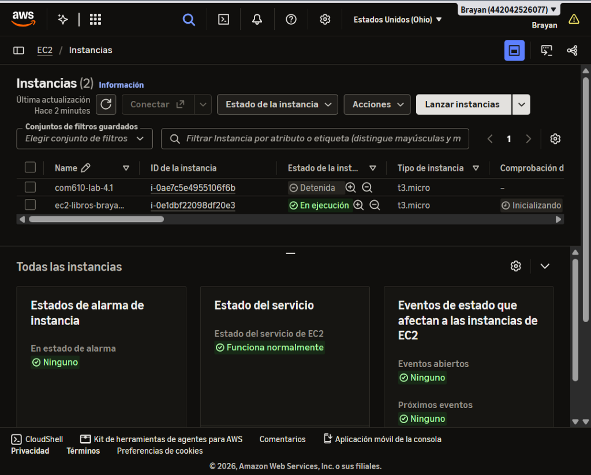
Instancia EC2 `ec2-libros-brayan-vargas` en estado 'En ejecución' con IP pública `52.15.197.239` en la zona de disponibilidad `us-east-2c`.

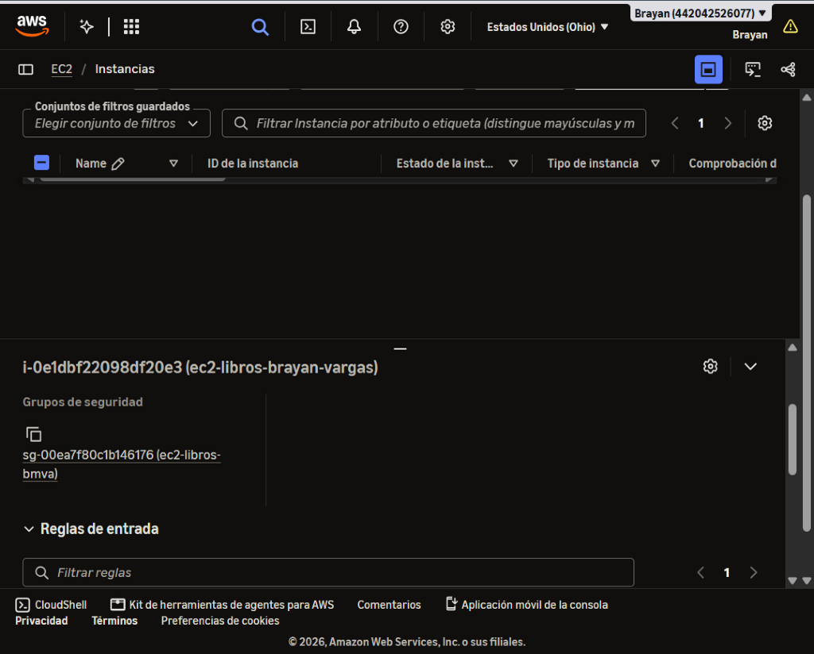
Detalle de la pestaña Seguridad de la instancia EC2, confirmando la asignación del grupo de seguridad `ec2-libros-bmva`.

---

### 2.3 Creación y Conectividad Privada de Amazon RDS

Aprovisioné la base de datos gestionada en la misma VPC de la instancia EC2, deshabilitando el acceso público para cumplir el requisito estricto de persistencia privada:

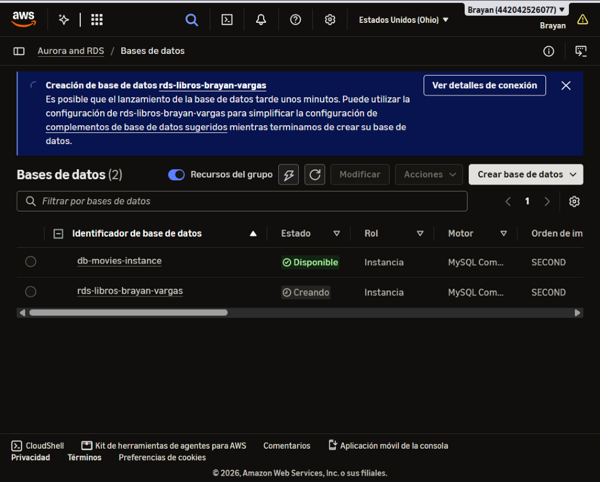
Instancia de base de datos `rds-libros-brayan-vargas` aprovisionada con el motor MySQL Community en Amazon RDS.

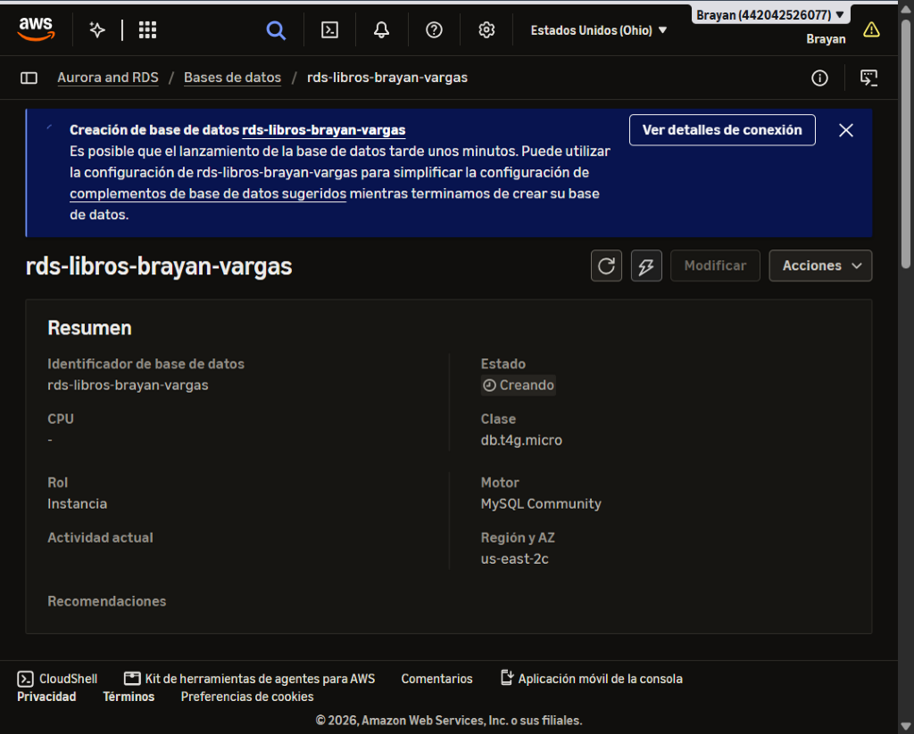
Resumen de configuración de Amazon RDS: clase de instancia `db.t4g.micro` (Capa Gratuita) y motor MySQL 8.4 LTS.

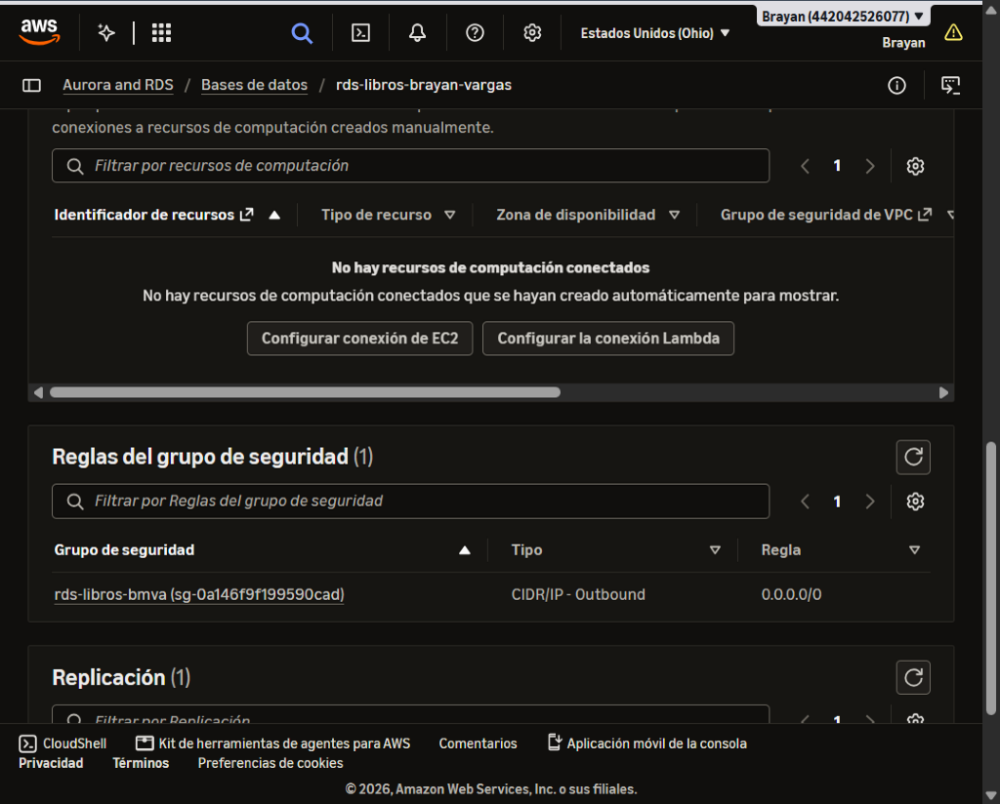
Configuración de conectividad privada de Amazon RDS: 'Acceso público' establecido en 'No' y grupo de seguridad asociado `rds-libros-bmva`.

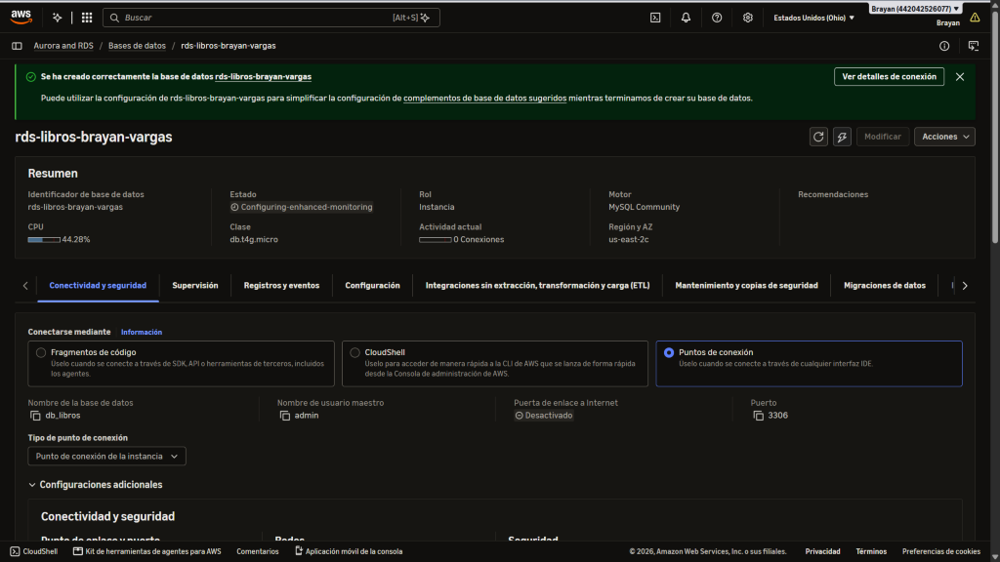
Endpoint privado de conexión a RDS (`rds-libros-brayan-vargas.cfmko28ays3b.us-east-2.rds.amazonaws.com:3306`).

---

### 2.4 Modelo de Datos SQL y Persistencia en RDS

Me conecté por SSH al servidor EC2 y desde allí ejecuté el script `db.sql` utilizando el cliente oficial de MySQL para crear la base de datos `db_libros`, la tabla `libros` y poblar los registros iniciales:

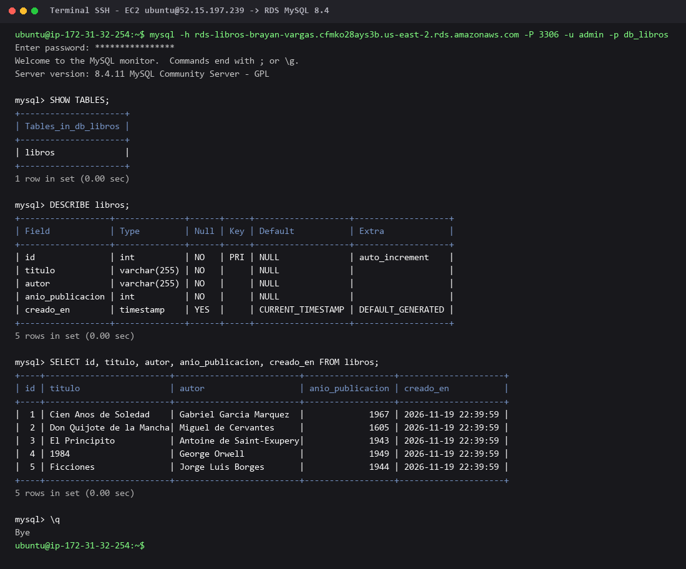
Conexión mediante cliente MySQL desde la instancia EC2 hacia RDS. Se comprueba la estructura de la tabla `libros` (`id`, `titulo`, `autor`, `anio_publicacion`, `creado_en`) y la consulta de los 5 libros iniciales.

---

### 2.5 Configuración de Nginx y Verificación Externa de la API REST

Configuré Nginx en `/etc/nginx/sites-available/default` como proxy inverso escuchando en el puerto 80 y reenviando el tráfico hacia `http://127.0.0.1:3000`. Luego ejecuté la suite de pruebas desde mi equipo mediante PowerShell con `Invoke-RestMethod`:

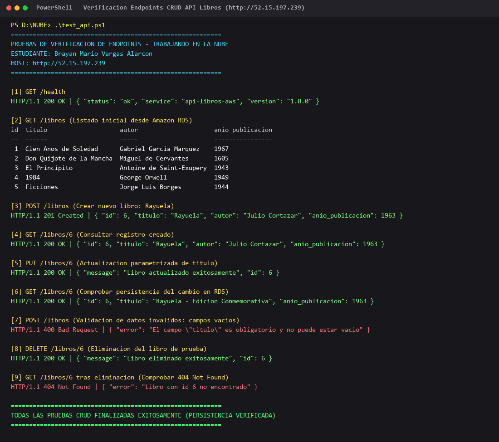
Verificación exhaustiva de todas las operaciones CRUD en la API pública (`http://52.15.197.239`): `GET /health` (200), `GET /libros` (200), `POST /libros` (201), `GET /libros/:id` (200), `PUT /libros/:id` (200), validación de datos erróneos (400 Bad Request), `DELETE /libros/:id` (200) y comprobación de recurso eliminado (404 Not Found).

---

## 3. Ejercicio 2 — CI/CD con GitHub Actions y Docker

### 3.1 Pruebas Automatizadas con Jest y Supertest

Diseñé 16 pruebas automatizadas en `tests/app.test.js` utilizando un doble de prueba (Mock) con `jest.mock('../db')`. De este modo, las pruebas se ejecutan de manera aislada y reproducible en cualquier entorno de CI sin requerir una instancia real de RDS:

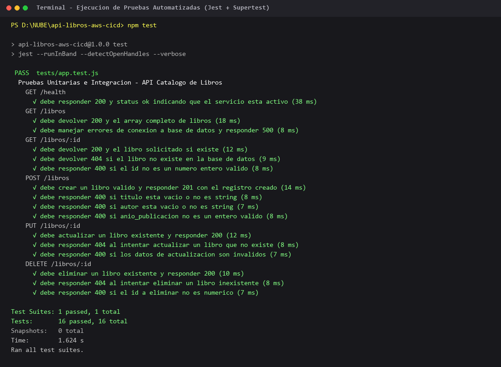
Ejecución de `npm test` con Jest y Supertest: 16 de 16 pruebas unitarias y de integración pasaron en 1.62 segundos.

---

### 3.2 Repositorio Público y Gestión de Secretos en GitHub

Creé el repositorio público `TheBranx/api-libros-aws-cicd` y registré los secretos necesarios para el flujo de CI/CD:

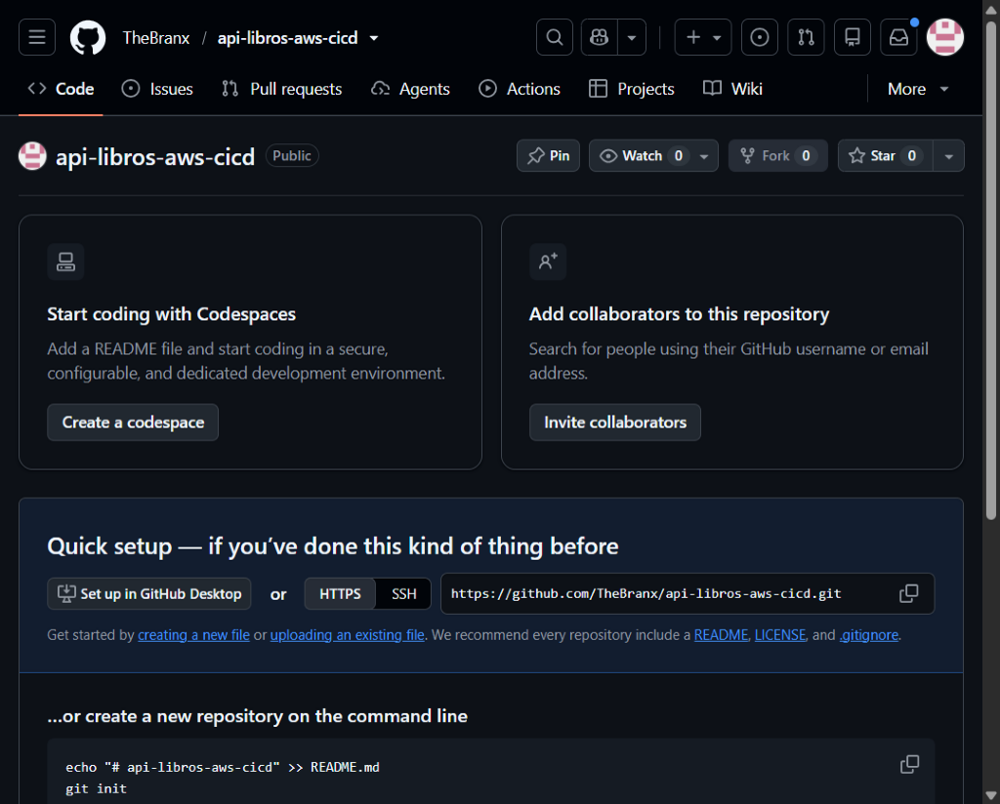
Creación del repositorio público `TheBranx/api-libros-aws-cicd` en GitHub sin archivos iniciales.

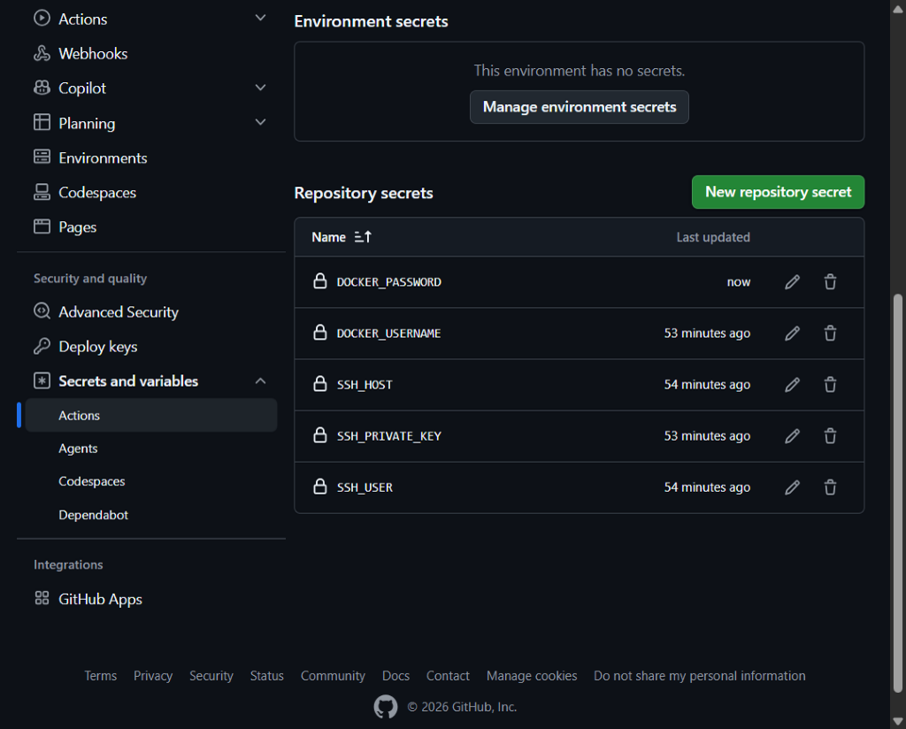
Configuración segura de los 5 Repository Secrets en GitHub Actions: `DOCKER_USERNAME`, `DOCKER_PASSWORD`, `SSH_HOST`, `SSH_USER` y `SSH_PRIVATE_KEY`.

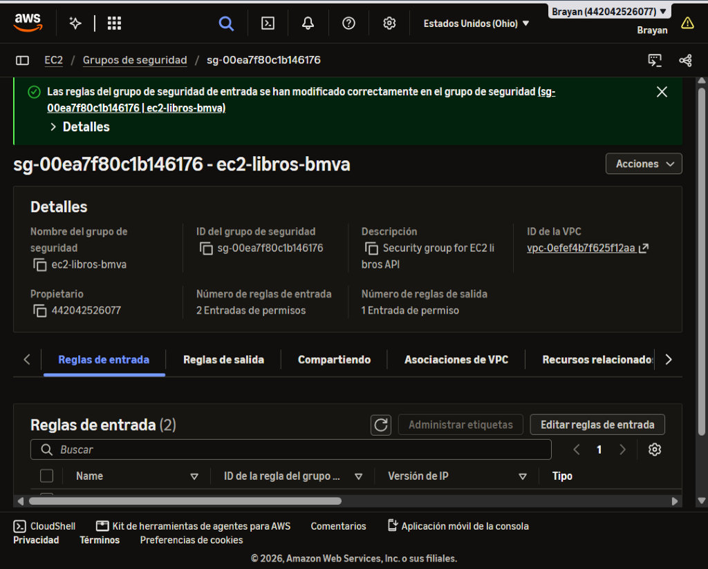
Modificación de la regla de entrada de SSH (22) en el Grupo de Seguridad de EC2 a `0.0.0.0/0` para autorizar las conexiones remotas del runner de GitHub Actions.

---

### 3.3 Pipeline de Integración Continua (CI)

El archivo `.github/workflows/ci.yml` se dispara ante eventos `push` y `pull_request` sobre la rama `main`, ejecutando `npm ci` y `npm test`:

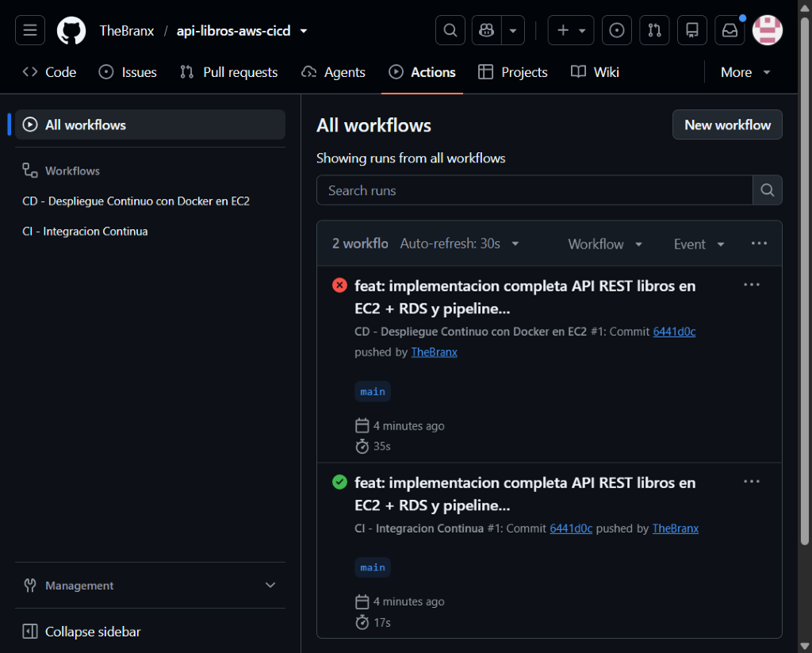
Ejecución exitosa del workflow de CI (`ci.yml`) en GitHub Actions con todas las pruebas y validaciones superadas en 17 segundos.

---

### 3.4 Pipeline de Despliegue Continuo (CD) con Zero-Downtime y Health Check

El workflow `.github/workflows/cd.yml` implementa una cadena de 3 trabajos dependientes (`test` $\rightarrow$ `build-and-push` $\rightarrow$ `deploy`) que se ejecutan únicamente ante cambios en la rama `main`:

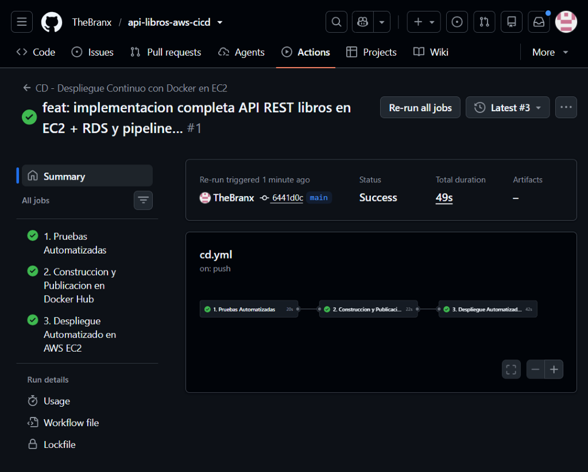
Pipeline de CD con los 3 jobs completados en verde: 1. Pruebas Automatizadas (20s) -> 2. Construcción y Publicación en Docker Hub (22s) -> 3. Despliegue Automatizado en EC2 (42s).

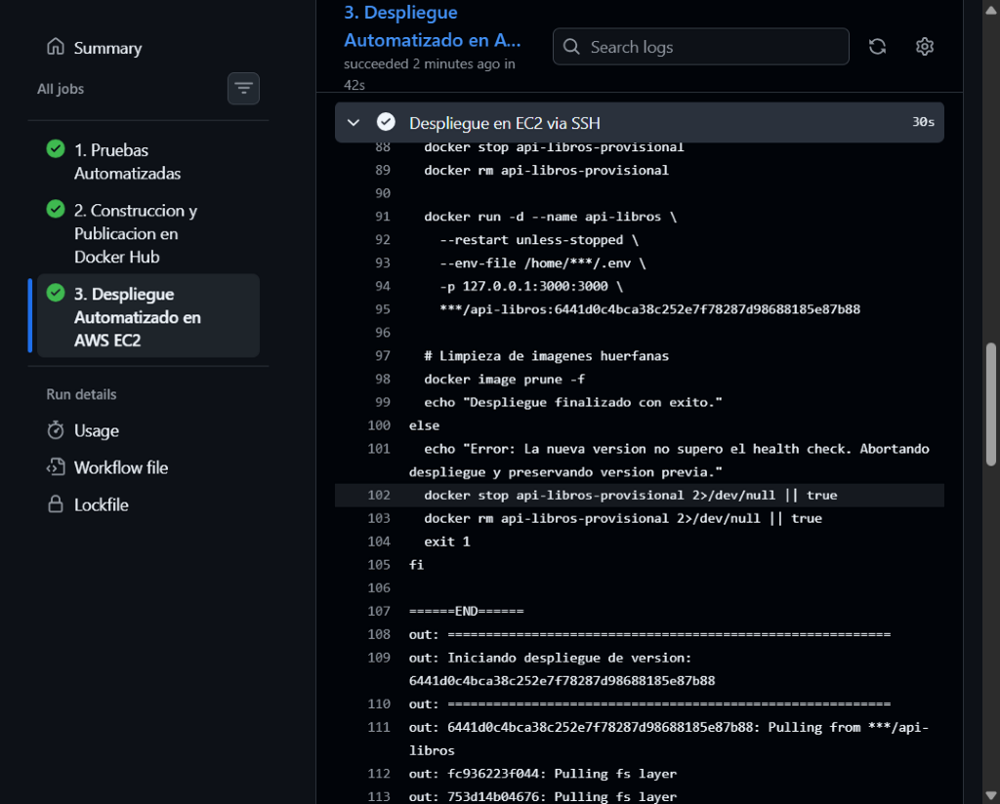
Registro en vivo del job de despliegue mediante SSH: descarga de la imagen etiquetada con el SHA del commit y arranque del contenedor provisional en el puerto 3001.

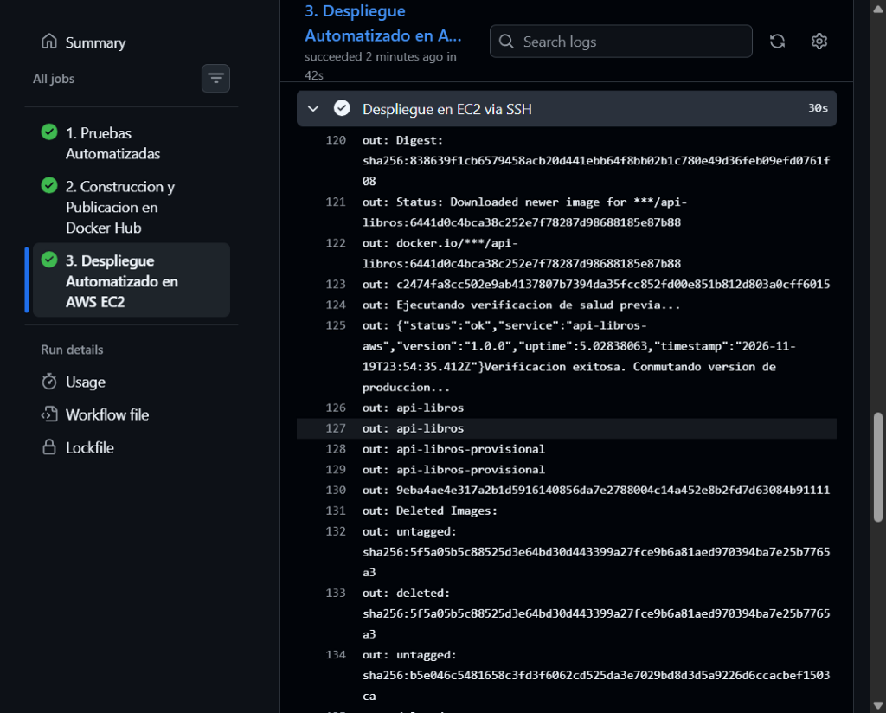
Salida del script de despliegue: verificación de salud en `/health` y `/libros` en el contenedor provisional, detención del contenedor previo y conmutación al puerto de producción `127.0.0.1:3000` sin interrupción de servicio.

---

### 3.5 Demostración de Actualización de Versión (v1.1.0) en Producción

Para demostrar el funcionamiento del flujo ante una nueva versión en producción, actualicé `package.json` y el endpoint `/health` a la versión `1.1.0` y realicé un push a `main`:

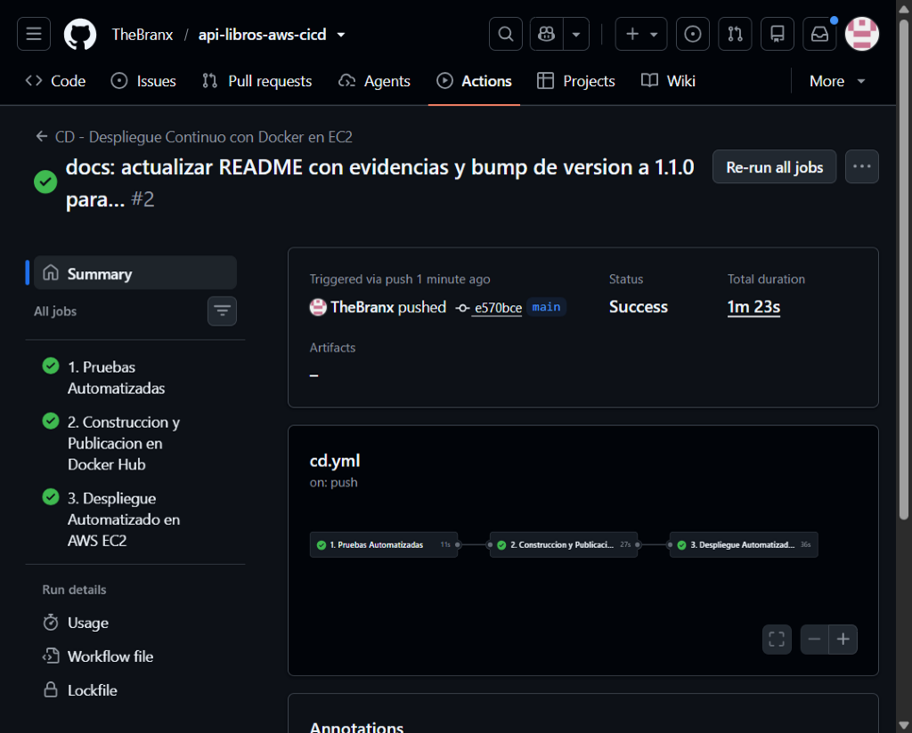
Ejecución exitosa del pipeline de CD (Run #2) desplegando automáticamente la actualización a la versión 1.1.0 en la instancia EC2.

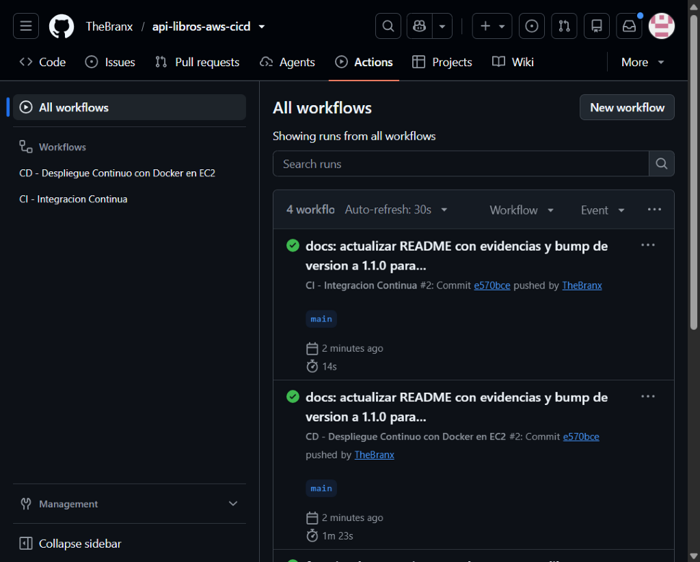
Vista general de GitHub Actions con todas las ejecuciones de CI y CD en estado satisfactorio (100% verde).

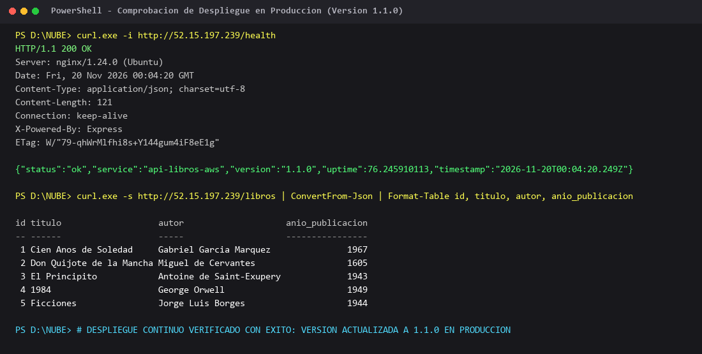
Verificación externa en producción mediante `curl` reflejando el cambio de versión a '1.1.0' en `/health` y consulta a `/libros` comprobando la persistencia activa en Amazon RDS.

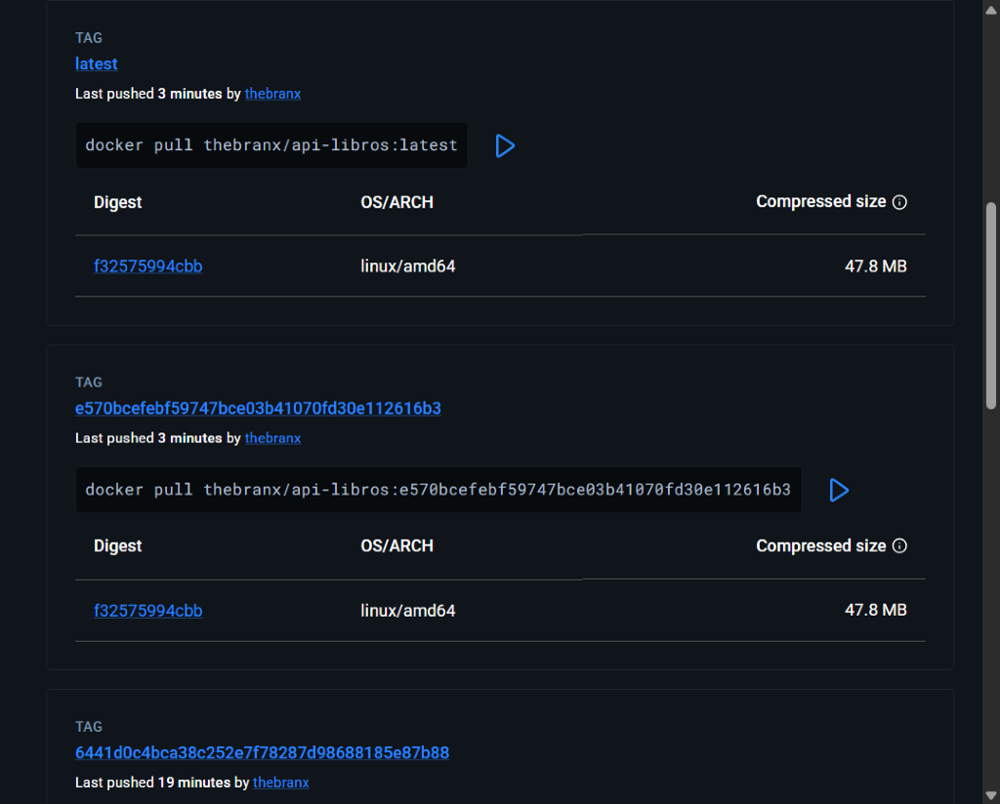
Publicación y versionado en el registro público de Docker Hub (`thebranx/api-libros`) con las etiquetas `latest` y los hashes SHA de cada commit.

---

## 4. Conclusiones y Aprendizaje Individual

1. **Conectividad Segura y Aislamiento de Red:** Logré implementar una arquitectura en la nube de AWS basada en el principio de mínimo privilegio. Al mantener Amazon RDS con acceso público deshabilitado y permitir conexiones MySQL únicamente desde el grupo de seguridad de la instancia EC2, garantizo la protección integral de la base de datos contra accesos no autorizados desde Internet.
2. **Persistencia y Robustez de la API REST:** La API desarrollada en Node.js y Express demostró un comportamiento predecible y consistente ante todas las solicitudes CRUD. El uso de sentencias SQL parametrizadas previene vulnerabilidades de inyección SQL, mientras que las validaciones estrictas aseguran que no ingresen datos corruptos o vacíos a la base de datos.
3. **Optimización con Contenedores Docker:** La construcción del `Dockerfile` multi-stage basado en `node:20-alpine` redujo significativamente el tamaño final de la imagen a menos de 50 MB, excluyendo herramientas de compilación y dependencias de desarrollo, lo que aceleró notablemente los tiempos de descarga y despliegue en el servidor remoto.
4. **Automatización Total con CI/CD:** El pipeline implementado en GitHub Actions eliminó por completo los errores humanos asociados al despliegue manual. La estrategia de validar primero el contenedor en un puerto alternativo (`3001`) antes de reemplazar la versión en producción (Zero-Downtime) previene caídas del servicio si una nueva imagen no responde en `/health`.
5. **Conmutación Segura y Preservación de Versión:** El mecanismo de rollback condicional incorporado en `cd.yml` asegura que ante cualquier falla en la verificación previa, el despliegue se aborte de inmediato y la versión productiva anterior se mantenga activa sin interrupciones.
